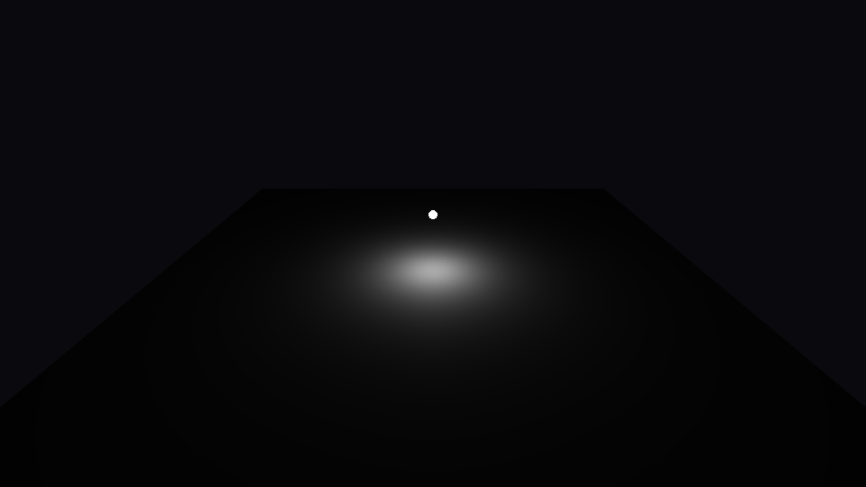
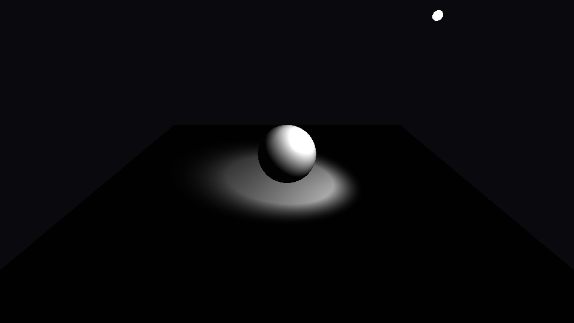
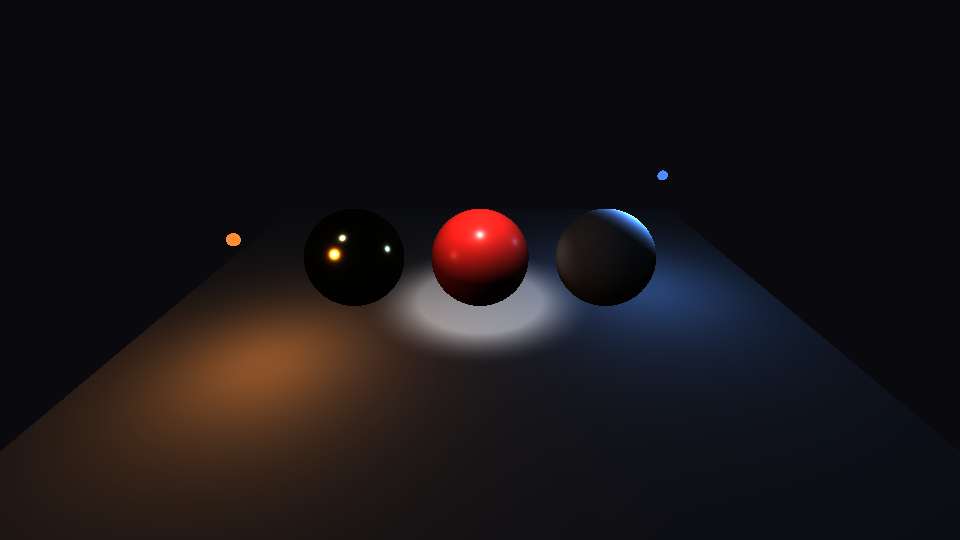

# Step 13 — Multiple & typed lights

> Part of the **GamePBR** devlog. Language: Odin · Target: CPU renderer → WebGPU.

**Status:** done — directional, point and spot lights (glTF `KHR_lights_punctual` conventions), inverse-square falloff with a range window, any number of lights summed through the BRDF, plus emissive materials; `make test` green (49/49).
**Goal:** Light a scene with more than one sun. Add the three standard light types, give them physically-based falloff, and sum them — the step where the rendering equation's integral becomes a loop.

## What & why
Since step 09 every scene has had exactly one directional light. That's enough to test a BRDF, but it's why smooth metal kept rendering black: a mirror reflects its surroundings, and one infinitely distant light is a single point in its surroundings. Real scenes have bulbs, lamps, flashlights — lights with *positions*, whose brightness depends on how far away you are.

The insight that makes this easy is that the BRDF never cared what kind of light it was. It only needs a direction `L` and the radiance arriving along it. So each light type is just a different answer to *"from where, and how much?"*, and shading a point becomes a sum.

## Theory

**From integral to sum.** The rendering equation integrates incoming light over the hemisphere:

```
Lo = ∫_Ω f(V, L) · Li(L) · (N·L) dL
```

A **punctual** light (point, spot, directional) delivers all its light along a *single* direction — its `Li` is a delta function. The integral of a delta collapses to evaluating the integrand at that one direction, so for `n` punctual lights:

```
Lo = Σ_k  f(V, L_k) · (N·L_k) · E_k
```

where `E_k` is what light `k` delivers at the point. That's the whole engine: a loop. It's also why we split each shading model into a per-light term `brdf_*(N, V, L)` that already includes `N·L` — the loop multiplies it by each light's radiance and adds.

**Directional (the sun).** So far away that its rays are parallel and its brightness doesn't change across the scene: `L = −dir` everywhere, delivered radiance = `color · intensity`. This is exactly what steps 09–12 used.

**Point (a bulb) and the inverse-square law.** A point light radiates equally in all directions from a position. Its power spreads over a sphere whose area grows as `4πd²`, so what arrives per unit area falls as **1/d²**:

```
d = |pos − P|,   L = (pos − P) / d,   E = color · intensity / d²
```

Double the distance, quarter the light. Combined with the `N·L` cosine, a point light hovering over a floor makes a pool that falls off as `cos³θ` — bright directly below, dropping fast toward the edges. (No ad-hoc "constant + linear + quadratic" attenuation knobs: those were the pre-PBR way, and they don't conserve energy.)

**Range window.** Pure 1/d² never reaches zero, so every light would touch every pixel forever — fine for correctness, terrible for a renderer that wants to skip far-away lights. glTF (following UE4) lets a light declare a `range` and fades it out smoothly:

```
window = saturate(1 − (d/range)⁴)²
```

Near the light it's ≈ 1 and leaves the physical falloff alone; it hits exactly 0 at `range` with zero slope, so there's no visible edge. `range = 0` means infinite.

**Spot (a flashlight).** A point light masked to a cone around its axis `dir`. Two half-angles: inside `inner` it's at full strength, outside `outer` it's dark, and in between it ramps. The ramp is done on the *cosine* of the angle, then squared for a softer shoulder (glTF's formula):

```
cd = dot(−L, dir)                               // cos of angle off-axis
t  = saturate((cd − cos(outer)) / (cos(inner) − cos(outer)))
E  = pointLight(E) · t²
```

**Emission.** A light bulb you can *see* is a surface that gives off light itself. glTF materials have an `emissiveFactor`: radiance added on top, unaffected by lighting. We use it to draw a small glowing marker at each light so the pictures show where the light *is*. (Emissive surfaces don't light other surfaces here — that's global illumination, out of scope.)

## Implementation
- **`src/render/lights.odin`** *(new)*
  - `Light` + `LightKind` (`Directional | Point | Spot`) and constructors `directional_light`, `point_light`, `spot_light`.
  - `light_sample(light, P) → (L, radiance)` — the single "from where, how much" question, with `range_window` and `spot_cone` as separate small helpers.
  - `brdf_eval(model, …)` dispatches to the Cook-Torrance or Blinn-Phong per-light term.
  - `shade_surface(ctx, mat, N, V, P, albedo)` — emission + ambient + the sum over lights. A context with no `lights` falls back to the old single `DirLight`, so every earlier step's scene renders identically.
- **`src/render/cook_torrance.odin`, `lighting.odin`** — each model split into `brdf_cook_torrance` / `brdf_blinn_phong` (the per-light term, `N·L` included). The original `shade_cook_torrance` / `shade_blinn_phong` remain as one-line wrappers, so all earlier tests still exercise them unchanged. `Material` gains `emissive`; `ShadeCtx` gains `lights: []Light`.
- **`src/render/pipeline.odin`** — the lit branch now just calls `shade_surface` with the interpolated world position `P` (which positional lights need, and which the pipeline has carried since step 09).

The heart of it:

```odin
col := mat.emissive + sh.ambient * albedo
for l in sh.lights {
    L, radiance := light_sample(l, P)
    col += brdf_eval(sh.model, mat, N, V, L, albedo) * radiance
}
```

Because `P` is interpolated per pixel (perspective-correctly), attenuation is evaluated per pixel too — the floor below is just two triangles, yet its light pool is perfectly smooth. Per-vertex lighting would need it tessellated finely.

## Results

A single point light one unit above a two-triangle floor. The pool is the inverse-square law made visible: brightest directly below, falling to almost nothing within a couple of units, because distance² and the slanting `N·L` both work against the edges:



A spot light (14° inner, 24° outer) aimed at a sphere. Note the soft ring between the two cone angles. Also note what's *missing*: there are no shadows, so the pool continues straight under the sphere — shadows need their own visibility pass, not a shading change:



The payoff — four lights at once: a warm orange point (left), a cool blue point (right, behind), a white spot from above, and a dim bluish directional "moonlight". The smooth **gold metal** sphere, which rendered black under one light in steps 11–12, now shows three distinct highlights — one reflection per light, each tinted gold by the metal's F0. The red plastic picks up the spot's white highlight over its diffuse body; the rough white sphere smears the blue light across its flank:



Running `make run` shows the same scene with the two point lights orbiting, highlights sliding across the spheres.

## Tests
`make test` → 49 total (math 13, render 30, mesh 6). New (`src/render/lights_test.odin`):
- **Directional** — same `L` and radiance at any point.
- **Inverse-square** — radiance `I/d²` at d = 2, and quartered at d = 4; `L` points back at the light.
- **Range window** — ≈ physical at d = range/10, exactly 0 at and beyond the range.
- **Spot cone** — full on axis and inside the inner cone, strictly between 0 and 1 in the ramp, 0 outside the outer cone.
- **Linearity** — two identical lights give exactly twice one light.
- **Legacy fallback** — a context with no `lights` matches `shade_cook_torrance` exactly.
- **Emissive** — an unlit black material returns exactly its emission.

## Gotchas
- **Clipping.** Under the spot and near the bulbs, pixels exceed 1.0 and clip to flat white — the spot pool's centre has no gradient left. Inverse-square makes this unavoidable: radiance near a light is unbounded. That's the problem step 14 (HDR tonemapping) exists to solve.
- **Lights are "punctual".** A point light has zero size, so its reflection in a perfectly smooth mirror would be a zero-size dot; our roughness floor (0.04) keeps it a few pixels wide. Real area lights would give soft, shaped highlights.
- **No shadows.** Every light reaches every surface facing it, even through other objects.

## Next
→ **Step 14 — Tonemapping & gamma:** treat these values as HDR radiance, compress them into displayable range (Reinhard, ACES) instead of clipping, and apply the sRGB transfer curve — the step where the renders finally stop looking "CG-dark".
