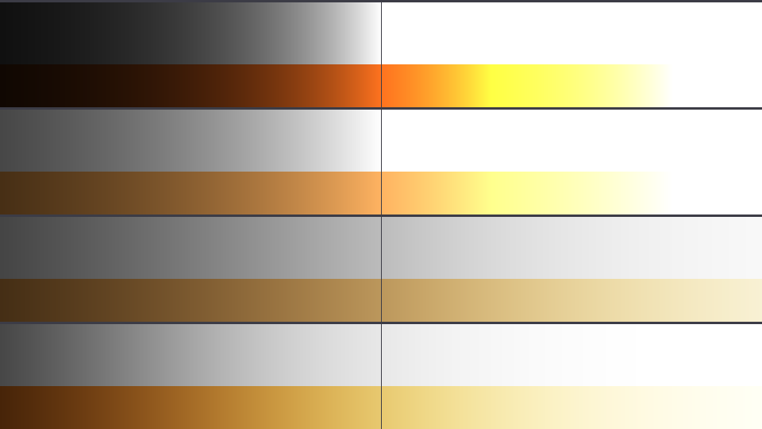
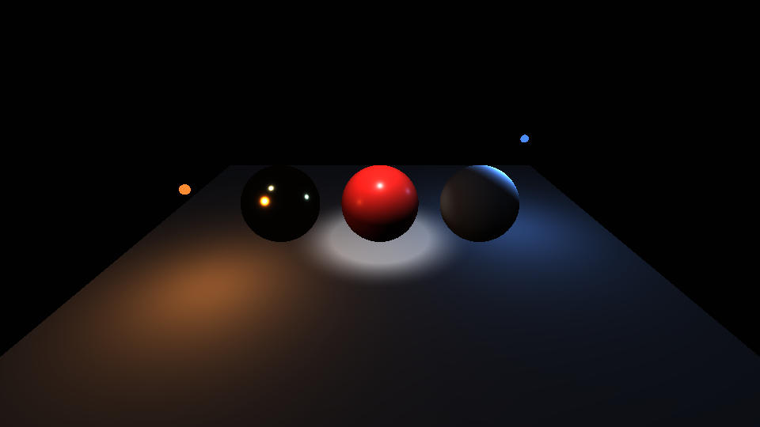
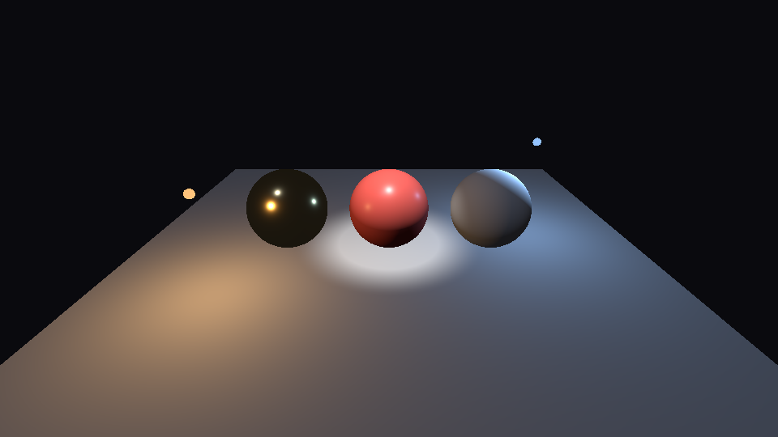
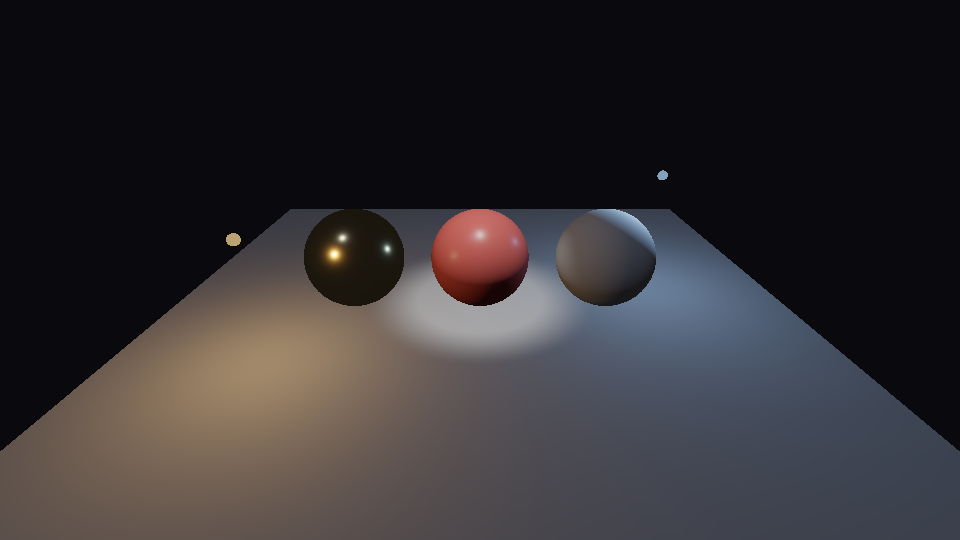
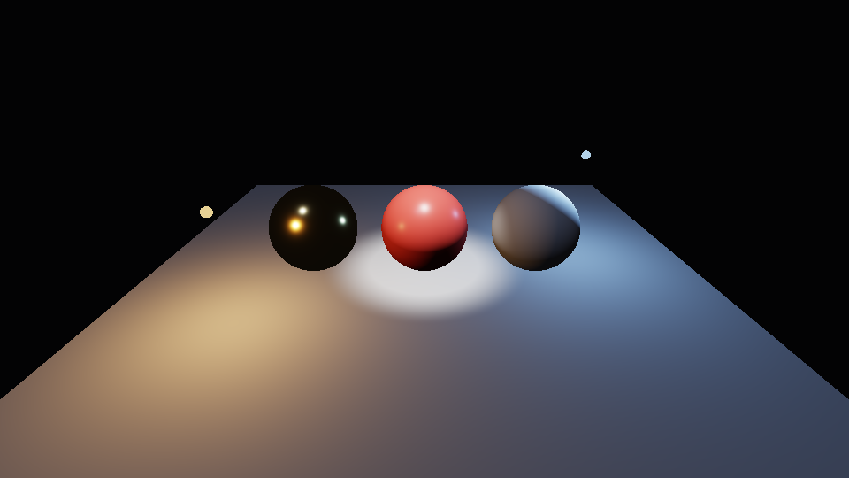
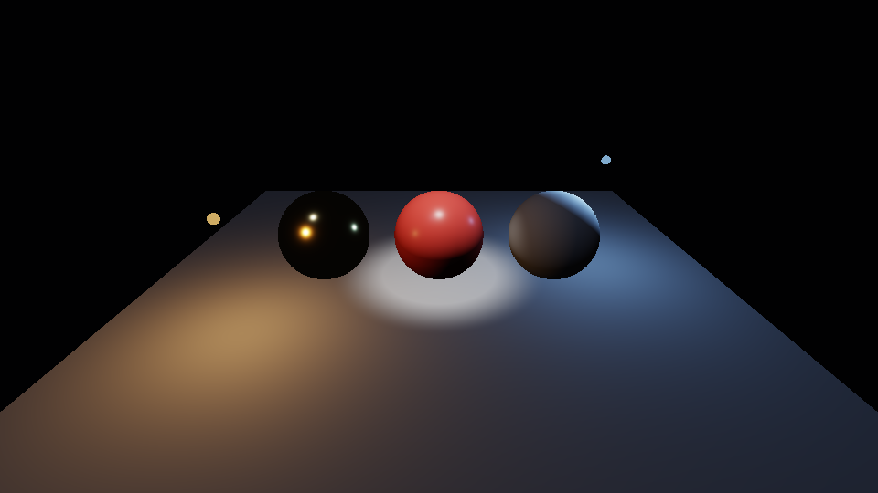
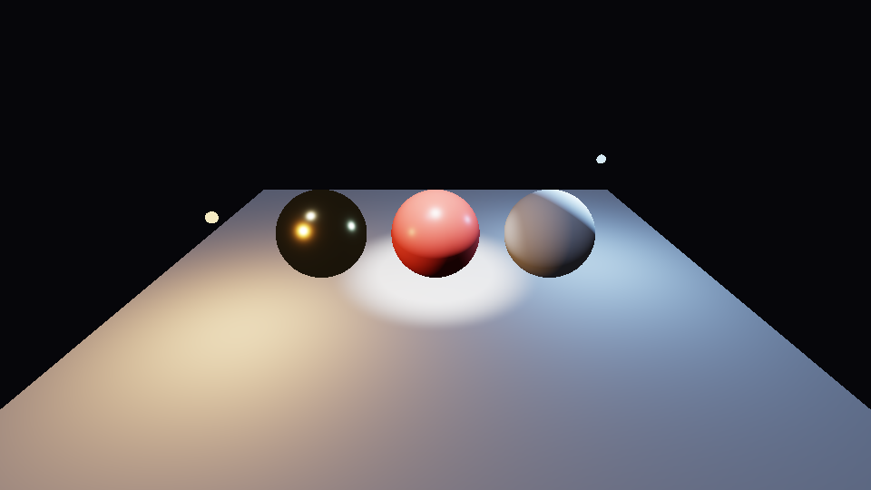

# Step 14 — Tonemapping & gamma

> Part of the **GamePBR** devlog. Language: Odin · Target: CPU renderer → WebGPU.

**Status:** done — an HDR float buffer, a display transform (exposure → tonemap → sRGB → 8-bit) applied in a separate resolve pass, with Clamp / Reinhard / ACES operators; `make test` green (55/55).
**Goal:** Stop throwing information away at the last step. Keep the renderer's output as unbounded linear radiance, then map it to the screen deliberately: compress the highlights instead of clipping them, and encode for the display's sRGB curve instead of writing linear numbers into an image format that expects otherwise.

## What & why
Since step 03 the last line of the pixel loop has been `u8(saturate(col) * 255)`. That one line does two wrong things.

1. **It clips.** Step 13's lights produce radiance far above 1.0 near the bulbs and under the spot. Everything above 1 becomes the same flat white, so the spot pool loses its gradient and bright colours lose their hue (an orange at 3× brightness clips to yellow).
2. **It skips the display encoding.** Our values are *linear* — twice the number means twice the light — but PNGs and monitors assume *sRGB-encoded* values. Writing linear numbers straight into an sRGB image makes every mid-tone far too dark. That's the "CG-dark" look of every render so far.

The fix is to separate *rendering* from *displaying*. The renderer writes physical radiance, unclamped, into a float **HDR buffer**. A separate **resolve** pass then applies a **display transform** to every pixel:

```
radiance  →  × 2^EV (exposure)  →  tonemap operator  →  sRGB encode  →  8-bit
```

## Theory

**Linear vs. sRGB.** Light adds linearly, so all lighting math (sums over lights, `N·L`, the BRDF) must run on linear values. Human vision is *not* linear: we're far more sensitive to changes in dark tones than in bright ones. sRGB is an encoding that spends more of the 256 code values on darks. Its standard curve (IEC 61966-2-1) is a short linear toe joined to a 2.4 power:

```
encode(x) = 12.92·x                    if x ≤ 0.0031308
          = 1.055·x^(1/2.4) − 0.055    otherwise
```

The consequence that surprises everyone: **linear 0.5 encodes to 0.735**, and sRGB 0.5 is only **0.214** linear. "Half as bright" is not "half the code value". Two rules follow:
- **Encode once, at the very end**, after all lighting.
- **Decode sRGB inputs on the way in.** Albedo textures painted by artists are stored sRGB and must be decoded before shading; data textures (roughness, metallic, normals) are stored linear and must *not* be. (Our panel textures from step 12 are generated directly in linear space, so there's nothing to decode yet — but a loaded PNG albedo would need `srgb_to_linear` per texel.)

**Dynamic range and tonemapping.** A real scene spans enormous brightness ratios: the bulb, the lit floor under it, the shadowed far corner. A display spans about 1:1000. A **tonemap operator** is a curve `[0, ∞) → [0, 1)` that squeezes the scene's range into the display's, ideally keeping mid-tones where they are and rolling bright values off gradually instead of clipping them.

- **Clamp** — `min(x, 1)`. Not tonemapping at all; it's what steps 09–13 did.
- **Reinhard** — `x / (1 + x)`. Maps 0→0, 1→½, ∞→1. It never clips, but it compresses *everything*, including the mid-tones, so images look flat and greyish.
- **ACES (filmic)** — an S-curve modelled on film response: a dark **toe** (deeper blacks, more contrast in the shadows), punchy **mid-tones**, and a soft **shoulder** that rolls highlights into white. We use Krzysztof Narkowicz's rational fit:
  ```
  f(x) = x(2.51x + 0.03) / (x(2.43x + 0.59) + 0.14)
  ```
  This is the look most engines default to.

All three are applied **per channel** here. That's simple and standard, but as a channel nears its ceiling it compresses more than the others, so bright saturated colours drift toward white. That drift is gentle with a shoulder (ACES, Reinhard) and harsh with a clip.

**Exposure.** Before the operator, scale by `2^EV`, the same "stops" a camera uses: +1 EV doubles the light, −1 EV halves it. Exposure picks *which* part of the scene's range lands in the curve's sweet spot. Auto-exposure, which measures the scene's average luminance and sets EV from it, is the natural next refinement.

**Why a separate HDR buffer?** The display transform only depends on each pixel's own value, so we *could* apply it inline as each pixel is shaded. Keeping an HDR buffer instead means one render can be resolved many ways (all six comparison images below come from a **single** render). It's also what auto-exposure and bloom will need, since both look at the whole HDR image before deciding anything.

## Implementation
- **`src/fb/framebuffer.odin`** — `Framebuffer` gains `hdr: [][3]f32` (linear radiance per pixel) and `clear_hdr`. The 8-bit `pixels` and the HDR buffer are cleared separately because they live in different colour spaces: a background given as an 8-bit sRGB colour is stored in the HDR buffer as `srgb_to_linear(bg)`, so it round-trips exactly through clamp + sRGB.
- **`src/render/pipeline.odin`** — one added line: every shaded pixel also writes its unclamped `col` into `f.hdr`. The old clamped write to `pixels` stays, so every earlier step renders exactly as before unless it calls `resolve`.
- **`src/utils/srgb.odin`** *(new)* — `linear_to_srgb` / `srgb_to_linear`, exact piecewise curves, plus `Vec3` versions.
- **`src/utils/tonemap.odin`** *(new)* — `Tonemap` (`Clamp | Reinhard | ACES`), `Display { op, exposure_ev, srgb }`, the operators, `display_transform` (the pure per-pixel chain), `encode_pixel` (which **rounds** to 8 bits; the old `to_color` truncated, biasing dark by half a code value), and `resolve(f, display)`.
- **`Makefile`** — `make test` now also runs `src/utils`.

The resolve pass in full:

```odin
display_transform :: proc(hdr: Vec3, d: Display) -> Vec3 {
    c := hdr * pow(2, d.exposure_ev)
    switch d.op {
    case .Clamp:    c = saturate(c)
    case .Reinhard: c = tonemap_reinhard(c)
    case .ACES:     c = tonemap_aces(c)
    }
    if d.srgb { c = linear_to_srgb3(c) }
    return c
}
```

## Results

**The curves themselves.** Each band is one display transform, from top to bottom: Clamp (linear output), Clamp + sRGB, Reinhard + sRGB, ACES + sRGB. Across each band, HDR radiance rises on a log scale from 1/16 at the left to 16 at the right, and the thin vertical line marks **1.0**. The top of each band is grey and the bottom is a saturated orange:



Read it band by band:
- **Clamp, linear:** the left half is crushed nearly to black (no sRGB), then everything right of 1.0 is the same white. The orange clips one channel at a time, so it turns *yellow* before it turns white.
- **Clamp + sRGB:** the darks open up, but it's still a hard clip at 1.0.
- **Reinhard:** no clip anywhere, but even 16× radiance is still light grey. The whole band is low-contrast.
- **ACES:** deep blacks at the left (the toe), a strong gradient through the middle, and a smooth roll into white. The orange desaturates gracefully toward cream instead of skewing yellow.

**One render, resolved four ways.** This is step 13's four-light scene, rendered *once*:

| Clamp, linear (steps 09–13) | Clamp + sRGB |
|---|---|
|  |  |
| **Reinhard + sRGB** | **ACES + sRGB** |
|  |  |

The sRGB encode alone is the biggest single change: the floor's falloff, which was a few dark pixels before, becomes a readable gradient across the whole plane. Clamp still burns the spot pool into a flat white disc. Reinhard keeps it, but the image goes grey and the red plastic turns pink. ACES keeps the gradient in the pool *and* the contrast. The red stays red, the gold metal's three highlights stay distinct, and the darks stay dark.

**Exposure** — ACES at −1 EV and +1 EV. The same HDR data, with the camera stopped down and opened up:

| ACES, −1 EV | ACES, +1 EV |
|---|---|
|  |  |

`make run` shows the live orbiting-lights view, now resolved with ACES + sRGB every frame.

## Tests
`make test` → 55 total (math 13, render 30, mesh 6, **utils 6**). New (`src/utils/tonemap_test.odin`):
- **sRGB known values:** 0→0, 1→1, the toe/power seam (0.0031308 ↔ 0.04045), linear 0.5 → 0.735 and sRGB 0.5 → 0.214.
- **sRGB round trip:** `decode(encode(x)) = x` across [0, 1].
- **Reinhard:** 0→0, 1→½, monotonic, never reaches 1.
- **ACES:** ≈0 at 0, monotonic, saturates to 1 for very bright input.
- **Exposure stops:** +1 EV doubles, −2 EV quarters.
- **Background round trip:** a background stored as `srgb_to_linear(bg)` resolves back to exactly `bg` under clamp + sRGB.

## Gotchas
- **ACES crushes near-black.** Its toe pushes very dark values toward 0, so our dark-blue background (0.003 linear) resolves to pure black under ACES but stays visible under Clamp and Reinhard. That's the operator doing its job (deeper blacks); a scene that wants a visible dark sky must make it brighter in *radiance*.
- **The light markers changed colour.** An emissive orange of 1.0 sits on ACES's shoulder, so it desaturates toward pale yellow. Emissive surfaces now live in HDR too, and a "glowing" marker probably wants intensity well above 1.
- **Don't encode twice.** The live window and the PNG writer both receive already-encoded pixels; neither may apply gamma again. (raylib's texture upload is a plain copy, so this holds.)
- **Earlier steps' images were never wrong, only linear.** Each step's figures are left as they were rendered, so the series shows the progression.

## Next
→ **Step 15 — Diffuse image-based lighting:** replace the flat `ambient` constant (the last non-physical term left) with light from a real environment. Load an equirectangular HDR sky and convolve it into an irradiance map, so every surface is lit by the whole sky, from every direction, with the right colour.
