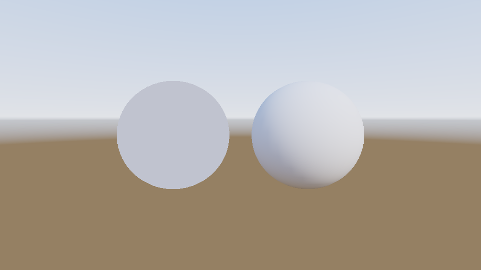

# Step 15 — Diffuse image-based lighting

> Part of the **GamePBR** devlog. Language: Odin · Target: CPU renderer → WebGPU.

**Status:** done — HDR equirectangular environment map (procedural sky), irradiance convolution, diffuse IBL replacing the flat ambient term, and the sky drawn as the background; `make test` green (63/63).
**Goal:** Remove the last non-physical term in the shader. The constant `ambient` stood in for "all the light that doesn't come from a lamp". Replace it with light from an actual environment, arriving from every direction with the right colour and strength.

## What & why
Since step 09 every shader has ended with `+ ambient · albedo`: one flat colour added everywhere, regardless of which way the surface faces. A sphere lit only by ambient is a flat disc. That's not how the world looks. A white ball outdoors is bluish where it faces the open sky, warm where it faces the sun, and brownish underneath where it sees the ground. It's lit by its **environment**: the whole sphere of directions around it, each with its own radiance.

**Image-based lighting (IBL)** stores that environment as an image and lights surfaces from it. It splits into the same two lobes as the BRDF:
- **Diffuse IBL** (this step) — the Lambert term integrated over the whole sky.
- **Specular IBL** (step 16) — the reflection, which depends on roughness and view direction.

## Theory

**The environment map.** An image holding the radiance arriving from every direction. We use the **equirectangular** (latitude-longitude) layout: `u` runs around the horizon (longitude φ), `v` runs from straight up to straight down (polar angle θ). A direction `d` and a texel `(u, v)` convert both ways:

```
u = 0.5 + atan2(d.x, −d.z) / 2π        d = (sinθ·sinφ,  cosθ,  −sinθ·cosφ)
v = acos(d.y) / π                       θ = v·π,   φ = (u − 0.5)·2π
```

The texels hold **linear HDR radiance**, not 8-bit colour. In a real sky the sun disk is hundreds of times brighter than the blue around it, and that ratio is the whole lighting story, so it can't be clamped to [0,1]. Real environments ship as `.hdr` / `.exr` photographs; this step generates one procedurally (gradient sky, a sun disk at 300× sky radiance with a soft glow, a brown ground), which needs no asset files and is deterministic for tests.

**Solid angle.** The lat-long layout is distorted: every row has the same number of texels, but rows near the poles cover tiny slivers of sphere. Any integral over the map must weight each texel by the **solid angle** it covers:

```
dω = (2π / W) · (π / H) · sin θ
```

Summed over all texels this gives 4π, the whole sphere, which is a unit test. Forget the `sin θ` and the poles get counted many times over, and everything picks up the colour of the zenith and the ground.

**Irradiance.** From step 10, a Lambert surface reflects `(albedo/π) · E`, where `E` is the **irradiance**: all incoming radiance, weighted by the cosine.

```
E(N) = ∫_Ω L(ω) · max(N·ω, 0) dω
```

For punctual lights this integral collapsed to a sum (step 13). For an environment it's a real integral over the whole sky, and it doesn't depend on the surface at all, **only on the normal N**. So it can be precomputed once for every possible normal and stored in another lat-long map, the **irradiance map**. That's the "convolution": each output texel is the environment blurred by a cosine lobe the size of a hemisphere. At shading time diffuse IBL is a single lookup:

```
Lo_diffuse = kd · (albedo / π) · E(N)
```

Because a cosine lobe is so wide, the irradiance map has almost no detail, so it can be tiny: **32×16** here. For the same reason the source can be downsampled first (box-filtered 512×256 → 128×64) without changing the result. Averaging preserves the total light, and the convolution would blur that detail away anyway.

**Fresnel without a half-vector.** Direct lighting used Fresnel at `V·H`, but environment light comes from every direction, so there's no single `H`. The standard approximation evaluates Fresnel at `N·V` and caps the grazing boost by roughness, because rough surfaces don't show a strong Fresnel rim:

```
F = F0 + (max(1 − roughness, F0) − F0) · (1 − N·V)⁵
kd = (1 − F)(1 − metallic)
```

`kd` then plays exactly its step-11 role: whatever reflects specularly isn't available to diffuse, and **metals have no diffuse at all**.

## Implementation
- **`src/render/env.odin`** *(new)* — `EnvMap` (lat-long, `[]Vec3` linear radiance) with:
  - `dir_to_equirect` / `equirect_to_dir`, `env_texel_dir`, `env_texel_solid_angle`;
  - `env_sample` / `env_sample_uv`, bilinear, wrapping in longitude and clamping in latitude;
  - `env_downsample`, a box filter;
  - `convolve_irradiance(src, w, h)`, a brute-force Riemann sum of `L·max(N·ω,0)·dω` over every source texel for every output normal. The `L·dω` products and texel directions are precomputed once, so the inner loop is a dot product and a multiply-add. On a 128×64 source to a 32×16 output it takes milliseconds;
  - `make_sky_env`, the procedural sky.
- **`src/render/ibl.odin`** *(new)* — `fresnel_schlick_roughness` and `ibl_diffuse(mat, N, V, albedo, irradiance)`.
- **`src/render/background.odin`** *(new)* — `camera_ray` (the world-space direction through a pixel, built from the camera's forward/right/up basis and field of view) and `draw_env_background`, which fills the frame with the sky as the camera sees it. It writes into the HDR buffer, so the sky goes through the same tonemapper as everything else.
- **`ShadeCtx`** gains `env_irr`. **`shade_surface`** uses `ibl_diffuse` in place of `ambient · albedo` when an irradiance map is present and the model is PBR. Otherwise it behaves exactly as before.

## Results

**The environment** (ACES + sRGB), the full sphere unrolled: sky gradient, sun at upper right with its glow, ground below the horizon:


**Its irradiance map**, shown as `E/π` so it's on the same scale as the sky. Each texel answers *"how much light does a surface facing this way receive?"*. Every detail is gone, blurred by a hemisphere-wide cosine lobe. Normals facing away from the sun (the blue region at left) see mostly blue sky. Normals facing the sun (the right half) are washed warm-white, and the sun's influence spreads across nearly half the map. Downward normals see brown ground.


**Flat ambient vs. diffuse IBL.** Both spheres are the same rough grey material in the same sky. The left one gets a flat ambient set to the sky's *average* radiance: exactly as much total light, delivered evenly. It renders as a featureless disc. The right one gets diffuse IBL: warm and bright where it faces the sun, cool blue on the side facing open sky, darker underneath where it sees ground. No lights are in the scene; all of that shape comes from the sky:



**Materials under the sky alone.** White rough, red plastic, teal plastic, and gold metal:


The three dielectrics now sit convincingly in their environment. The **gold metal is pure black**, and that's correct for this step: a metal has no diffuse lobe (`kd = 0`), so diffuse IBL gives it nothing. Everything a metal shows is *reflection*, and reflecting the environment is specular IBL, step 16. (The dielectrics are also missing their reflections, but at ~4% Fresnel it's subtle.)

`make run` orbits the camera around the row, and the sky turns behind it.

## Tests
`make test` → 63 total (math 13, render 38, mesh 6, utils 6). New (`src/render/env_test.odin`):
- **Equirect round trip** — −Z maps to the image centre; direction → (u,v) → direction is the identity.
- **Solid angles** — texels sum to 4π.
- **Uniform sky** — radiance 1 from every direction gives irradiance π for every normal.
- **Half sky (analytic)** — radiance 1 above the horizon, 0 below, gives `E = π(1 + N.y)/2`: π facing up, π/2 facing the horizon, 0 facing down. Checked across every output texel; worst error **0.001** (of π).
- **Downsample** preserves the mean radiance.
- **Sky layout** — the sun is >50× the sky, the ground darker than the sky.
- **Camera ray** — the centre pixel's ray is the camera's forward direction.
- **Diffuse IBL** — in a uniform white sky a white rough dielectric returns `(1 − F0) ≈ 0.96`; a metal returns 0.

## Gotchas
- **Brute-force convolution scales badly.** It's O(output × source): fine for 32×16 from 128×64, hopeless for 1024² cubemaps. Production engines use **spherical harmonics** (9 coefficients capture irradiance almost perfectly, since it's so smooth) or GPU importance sampling. Same integral, cheaper evaluation.
- **No shadowing from the environment.** A sphere's underside facing the ground is lit by the ground's radiance even where another object would block it. Fixing that needs ambient occlusion: `R` of the glTF `ORM` texture from step 12, or screen-space AO.
- **The sun is in the map.** Here it's part of the environment and smeared into the irradiance. Engines usually keep the sun as an analytic directional light (sharp shadows and highlights) and paint it *out* of the environment, so it isn't counted twice.

## Next
→ **Step 16 — Specular IBL (split-sum):** reflect the environment. Prefilter the sky into a chain of increasingly blurred maps (one per roughness), precompute the BRDF's response into a 2D lookup table, and combine the two at shading time. The black gold sphere finally reflects the sky.
