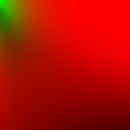
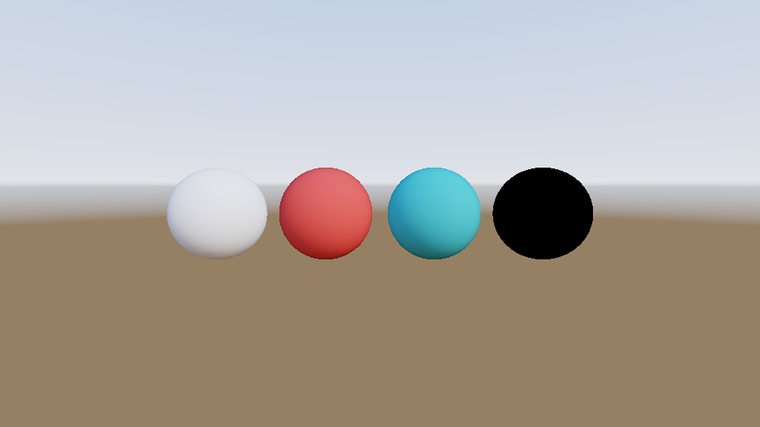
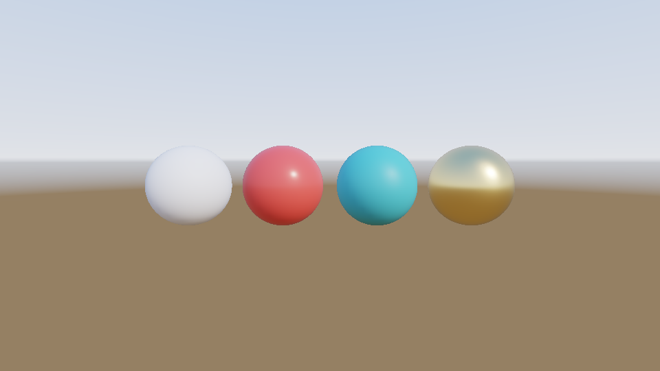
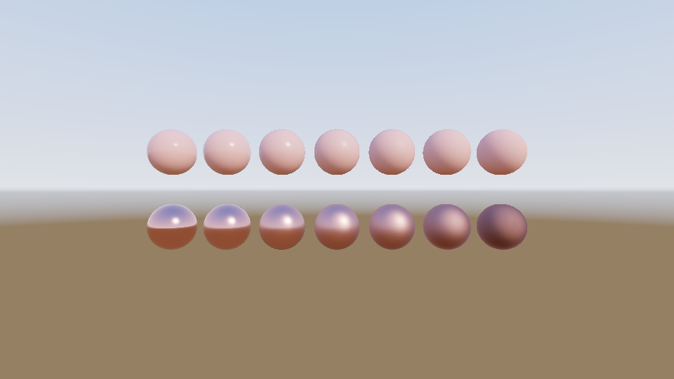

# Step 16 — Specular image-based lighting (split sum)

> Part of the **GamePBR** devlog. Language: Odin · Target: CPU renderer → WebGPU.

**Status:** done — GGX importance sampling, a prefiltered environment chain (filtered importance sampling), the split-sum BRDF lookup table, and full IBL (diffuse + specular), validated by a white-furnace test and an independent brute-force reference; `make test` green (68/68).
**Goal:** Make surfaces *reflect* their environment, sharply when smooth and blurred when rough, so metals finally look like metal. This completes the shading model.

## What & why
Step 15 lit surfaces with the *diffuse* half of the sky. That left the gold sphere pitch black, because a metal has no diffuse at all: everything you see on a metal is reflection. Dielectrics were missing their reflections too; they're only ~4% head-on, but they climb toward 100% at grazing angles.

The specular term is much harder than the diffuse one. Diffuse irradiance depended only on the normal, so it fit in a tiny 32×16 map. Specular reflection depends on the **view direction**, the **roughness**, *and* the Fresnel response:

```
Lo_spec(v) = ∫_Ω L(l) · f_spec(v, l) · (n·l) dl
```

Evaluating that integral per pixel is far too slow even for a CPU renderer that's allowed to be slow. Brian Karis's **split-sum approximation** (Unreal Engine 4, 2013) turns it into two lookups.

## Theory

**The split.** Approximate the integral of a product by the product of two integrals:

```
∫ L(l) · f(v,l)(n·l) dl   ≈   [ ∫ L(l) over the GGX lobe ]  ×  [ ∫ f(v,l)(n·l) dl ]
           exact                  prefiltered environment       BRDF integral (L = 1)
```

Each factor depends on fewer variables, so each can be precomputed:
1. The **prefiltered environment** depends on the reflection direction `R` and roughness. That's a 2D map per roughness level.
2. The **BRDF integral** depends on `n·v`, roughness and F0, with no environment at all. With Fresnel-Schlick, `F0` factors out as a scale and a bias:

```
∫ f(n·l) dl = F0 · A + B,   A = ∫ (1 − Fc) G_vis,   B = ∫ Fc G_vis,   Fc = (1 − v·h)⁵
```

So `(A, B)` is a 2D table over `(n·v, roughness)`, the **BRDF LUT**, which works for every environment and every material. At shading time:

```
R        = reflect(−V, N)
Lo_spec  = prefiltered(R, roughness) · (F0·A + B)
```

**Importance sampling.** Both integrals are dominated by the narrow GGX lobe. Step 10 sampled the hemisphere uniformly, which wastes nearly every sample on directions where the BRDF is zero. Instead, draw half-vectors **in proportion to the GGX distribution**: invert its CDF so that uniform numbers `(ξ₁, ξ₂)` map to a half-vector `H` with density `D(h)(n·h)`:

```
φ = 2π ξ₁,    cos θ = sqrt( (1 − ξ₂) / (1 + (α² − 1) ξ₂) ),    α = roughness²
```

then reflect `V` about `H` to get the light direction `L`. With the pdf matched to `D`, the `D` term cancels out of the estimator. The `(ξ₁, ξ₂)` pairs come from the **Hammersley** sequence (`i/N`, plus the bit-reversed `i`), which covers the square evenly rather than in random clumps, so a few hundred samples beat thousands of random ones.

**Prefiltering, and the N = V = R assumption.** To make the first factor depend only on `R` and roughness, Karis assumes the viewer looks straight down the normal while prefiltering: `N = V = R`. Each texel of a level is then the environment averaged over GGX-sampled directions around `R`, weighted by `n·l`. The cost is that reflections at grazing angles don't stretch into the long streaks real ones do. That's the main visual error of the method, and it's usually accepted.

**Filtered importance sampling.** Our sky has a sun 300× brighter than everything else. With a few hundred point samples per texel, some texels catch the sun and others miss it, which shows up as speckled fireflies in the rough levels. The fix (Křivánek & Colbert, 2008): each sample represents a patch of the sphere of solid angle `≈ 1/(N · pdf)`. So read the source environment from a **pre-blurred copy** (a box-downsampled mip chain) whose texels are about that size. Wide, sparse samples read blurry mips; tight, dense samples read sharp ones. A few hundred samples then give a smooth result.

**Roughness levels.** Five levels at roughness 0, 0.25, 0.5, 0.75, 1, each half the previous resolution, since blurrier content needs fewer texels. Level 0 is a perfect mirror and *is* the environment. Shading blends between the two nearest levels.

**The IBL geometry term.** The LUT's Smith-Schlick term uses `k = α/2`, not the `(r+1)²/8` from step 11. The two remaps are tuned differently: one for punctual lights, one for the hemispherical integral.

## Implementation
- **`src/render/sampling.odin`** *(new)* — `radical_inverse_vdc`, `hammersley`, `tangent_basis`, `importance_sample_ggx`.
- **`src/render/brdf_lut.odin`** *(new)* — `geometry_smith_ibl` (k = α/2), `integrate_brdf(n·v, roughness)`, which importance-samples A and B, `make_brdf_lut` (32×32, 512 samples), and a bilinear `brdf_lut_sample`.
- **`src/render/prefilter.odin`** *(new)* — `env_mip_chain` (box-downsampled source copies), `sample_mip_chain` (fractional mip), `prefilter_level`, which importance-samples per output texel and picks the mip from each sample's pdf, `prefilter_env` (all five levels), and `sample_prefiltered` (blending across roughness).
- **`src/render/ibl.odin`** — `IBLMaps` bundles the irradiance map, the prefiltered levels and the LUT, built once by `make_ibl_maps(env, settings)`. `ibl_specular` is the split-sum lookup; `ibl_total` = diffuse + specular.
- **`ShadeCtx`** gains `ibl: ^IBLMaps`. `shade_surface` prefers it over step 15's diffuse-only `env_irr`, which in turn beats flat `ambient`, so every earlier step still renders unchanged.

Precomputing all of it from the 512×256 sky takes about **1 second** on one CPU core (`make run` prints it). The prefiltered levels dominate that.

## Results

**The prefiltered chain** — roughness 0, 0.25, 0.5, 0.75, 1 from left to right. A sharp mirror of the sky widens into a broad wash, with no fireflies despite the 300× sun:


**The BRDF LUT** — red = A (the F0 scale), green = B (the bias). `n·v` runs left to right from 0 to 1, roughness top to bottom from 0 to 1. Green appears only at grazing angles on smooth surfaces (top-left), where Fresnel pushes every material toward a mirror. The bottom-right corner (rough, seen head-on) is dark red, and that's not a bug (see the furnace test below).



**Step 15's material row, now with reflections.** The gold sphere that was pitch black now mirrors blue sky above and gold-tinted ground below its horizon line, with the sun's glint. The plastics pick up faint reflections and a sun highlight over their diffuse colour:

| Diffuse IBL only (step 15) | Diffuse + specular IBL |
|---|---|
|  |  |

**The metallic × roughness chart from step 11, lit only by the sky.** In step 11 the metal row was black except for one tiny highlight each. Now every metal reflects its surroundings: smooth ones show a crisp horizon and a sharp sun glint, and both blur as roughness rises. The dielectric row keeps its diffuse body, with its reflection showing mostly near the rims:



## Tests
`make test` → 68 total (math 13, render 43, mesh 6, utils 6). New (`src/render/ibl_specular_test.odin`):
- **Radical inverse** — 1, 2, 3, 4 → 0.5, 0.25, 0.75, 0.125.
- **GGX samples** — unit half-vectors in the normal's hemisphere, bunching toward N as roughness falls.
- **LUT bounds** — `A + B ≤ 1` everywhere; ≈ 1 for smooth surfaces seen head-on; lower for rough ones.
- **Prefilter** — a uniform sky stays uniform at every level; level 0 equals the environment.
- **White furnace** — in a uniform white sky, total IBL never exceeds 1 for any roughness, metal or dielectric. Smooth surfaces return ≈ all of it, and for metals the value equals the LUT's `A + B` exactly.

## Gotchas
- **The furnace test caught a wrong assumption.** My first version demanded every surface return > 50% in a white furnace, and the rough metal returned only **35%**. Before changing anything I computed `A` and `B` independently in Python by brute force, a dense stratified sum over the whole hemisphere with no importance sampling. It agreed with the Odin LUT to three decimals (`A = 0.3146` vs `0.3149` at roughness 1, `n·v` = 0.95; `0.7285` vs `0.7272` at roughness 0.5, `n·v` = 0.5). The renderer was right and the test was wrong. **Single-scattering GGX loses energy**: light that bounces between microfacets more than once is simply dropped, and at roughness 1 that's most of it. It's why the roughest metals in the grid look darker than they should. The standard fix is a **multiple-scattering compensation** term (Kulla & Conty 2017; Fdez-Agüera 2019), which uses the same LUT.
- **B is tiny head-on.** `B ≈ 0.0001` at `n·v` = 0.95 looks like a bug, but Fresnel genuinely contributes almost nothing at normal incidence. It reaches 0.07 at `n·v` = 0.2.
- **No stretched reflections.** The `N = V = R` assumption makes grazing reflections round instead of streaky.
- **The sun is double-handled in real engines.** Here it lives only in the environment. Engines usually keep it as an analytic light (sharp highlight, shadows) and remove it from the environment, as noted in step 15.

## Next
→ **Step 17 — Performance pass:** the renderer is correct; now make it fast. Profile, split the frame into tiles across all CPU cores, and look at SIMD for the shading loop. The IBL precompute is the first obvious target.
